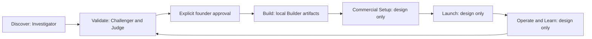

# VentureLab architecture

## Overview

VentureLab is a proposed six-phase AI co-founder. The Milestone 1 foundation and
Milestone 3 local Builder are implemented in this branch. Amen's Milestone 2 is a
separate workstream, not an existing API assumed by this implementation.

## Phases

### 1. Discover

Planned Investigator work structures the founder's brief and collects free public
sources with attribution. Milestone 1 provides source-verification primitives;
retrieval and orchestrated research are Milestone 2 work. Expected outputs are
sourced opportunities and explicitly unsupported assumptions. Builder does not
retrieve sources or verify supplied evidence.

### 2. Validate

Planned Challenger work identifies unsupported assumptions and risks. The Judge
explains deterministic evidence-gate outcomes, including what could change a decision
through Counterfactual Challenge. These interfaces remain unintegrated here.
The implemented Builder prepares hypotheses, neutral past-behavior interview
questions, ethical experiments, proposed measurable criteria, failure criteria and
next steps. Outputs are `phase2_step1_validation-kit.json` and `.md`.

### 3. Build

The implemented Builder renders a validated `LandingPageSpec` through a fixed HTML/CSS
template. Preparation creates a reviewable draft; final local writes require exact
founder approval. The result is an actual responsive page with assumption labels,
proposed features and an internal-anchor CTA, plus its JSON specification. No form,
tracking, external asset, publishing or outbound data path exists.

### 4. Commercial Setup

STUBBED design: the founder reviews positioning, operating costs, and setup requirements
outside this prototype. Future planning artifacts would identify assumptions and
manual tasks. No accounts, contracts, regulated advice, purchases or payments execute.

### 5. Launch

STUBBED design: prepare launch materials and a channel experiment for founder review.
External publication or communication would need a distinct approval tied to exact
content, destination and action. Milestone 3 has no implementation for these actions,
and generation approval cannot authorize them.

### 6. Operate and Learn

STUBBED design: compare genuinely observed results with previously approved criteria,
track contradictions and return evidence to the research workflow. Future tools must
separate observed facts from generated interpretation and preserve provenance.
No customers, signups, reviews or experiment results are synthesized.

## Gates

Business gates GO, REPEAT, PIVOT and STOP are Milestone 2 responsibilities. Weak
evidence must allow STOP; insufficient or conflicting evidence must not be promoted
by fluent prose. Counterfactual Challenge should specify evidence or experiments
that could justify reconsideration. These are architectural requirements, not
implemented Judge behavior in this branch.

The implemented founder gate has pending, approved, rejected, executing, executed
and failed_execution states. SHA-256 binds the complete bundle and rendered bytes.
Only an approved, unchanged, unconsumed action can write local output. Decisions,
blocked attempts and execution outcomes persist in SQLite with compatible audit keys.

## Sale to cash

STUBBED architecture only. A future permitted commerce design would map a confirmed
payment event to delivery, a refund event to access revocation, use idempotency to
prevent duplicate delivery, and reconcile orders, payments, fees and payouts.
Under this project's stricter policy all payment operations, including sandbox
transactions, remain disabled. There are no payment credentials, payment handlers,
transaction simulations or fabricated payment logs in Milestone 3.

## Data flow

`Milestone2Adapter.to_builder_input()` is a protocol for future mapping, not a fake
adapter. A validated brief and landing specification feed preparation. With `--model`,
the local Ollama model selects which supplied assumption the experiment tests (only
when there is more than one); everything else uses deterministic templates, so the
model never introduces factual prose, findings or HTML.
The complete bundle is fingerprinted and stored pending review. A trusted local
founder explicitly approves/rejects the same fingerprint, and execution consumes
that approval before file writes. Audit events retain the official action/source/
model/cost/approved_by fields and run/action identity.

## Built vs. stubbed

Built: Milestone 1 Python/FastAPI/Ollama/evidence foundation; Milestone 3 typed Builder
contracts, local templates, persistent approval guard, CLI and tests.
MOCKED: offline model transports only in unit tests.
STUBBED/unintegrated: full research agents and workflow, business gates, full UI,
commercial setup, external launch, delivery and ongoing learning. Payments disabled.
The existing Milestone 1 homepage is not a Milestone 3 interface.

## Roadmap

Amen maps real research outputs to the Builder boundary and merges actual action
logs. The team then tests end-to-end founder approval and evidence decisions before
updating the web UI status, producing the integrated gate outputs and recording the
demo. Multi-user approval requires authenticated server-side founder identity; the
current local CLI trusts the OS user and never exposes a public decision endpoint.
