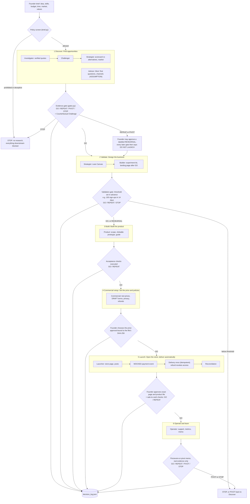
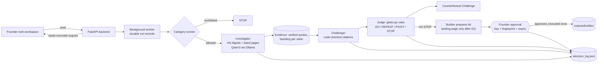

# VentureLab architecture

## Overview

VentureLab is a FastAPI application with a local open-weight model (Qwen3 through
Ollama) and ten agents across the six phases, each phase ending in a gate whose outcome is
GO, REPEAT, PIVOT or STOP. **Discover:** the **Investigator** retrieves public sources and
extracts claims whose quotations Python checks against the retrieved text; the
**Challenger** reviews the founder's numbered assumptions, and code decides what each
review rests on; the **Judge** is a fixed, ordered set of Python rules (`gates.py`) that
returns the decision with a counterfactual (`counterfactual.py`); the **Strategist**
scores the idea against alternatives; the **Advisor** (local model) proposes
idea-specific channels, prices, Mom Test questions and a stop rule, all labelled
ASSUMPTION. **Validate:** the Strategist builds the Lean Canvas and the **Builder** an
experiment kit (and, after GO, a landing page); a validation gate compares founder-reported
results with a threshold fixed in advance. **Build:** the **Product** agent writes the MVP
scope, a clickable prototype and a draft guide, then runs the acceptance checks.
**Commercial setup:** the **Commercial** agent drafts test prices and policies. **Launch:**
the **Launcher** drafts the store page and posts; payment, delivery, refunds and
reconciliation are MOCKED modules. **Operate and learn:** the **Operator** triages real
support requests, reports metrics and writes the persevere-or-pivot memo. Founder approvals
are bound to the exact file's SHA-256, anything short of a real GO says DO NOT LAUNCH, and
every agent action is appended to `decision_log.json`. The founder web workspace (`app/ui`)
drives Discover and the Builder through `app/api.py` (background worker `jobs.py`);
phases 2–6 run from `workflow.py` on the command line or from the web phase runner.



Discover and the Builder in detail:



Every arrow runs in the integrated application. The founder key never leaves the
founder's machine except inside a decision the founder submits.

## Phases

### Core steps of the case brief, mapped to code and outputs

Outputs are from the genuine run `run-a9f21cd634924cca` (Discover decided REPEAT, so phases 2–6
ran as a founder-approved REHEARSAL). Run files are in `outputs/runs/run-a9f21cd634924cca/`
(written `runs/…` below); phase 2–6 files are in `outputs/`.

| Core step | Part of the step | Code | Output | Status |
|---|---|---|---|---|
| **Find opportunities** | Sharpen the idea: validated brief, numbered founder assumptions questioned by the Challenger | [`brief.py`](brief.py), [`agents/challenger.py`](agents/challenger.py) | [`runs/…/phase1_step1_founder_brief.json`](outputs/runs/run-a9f21cd634924cca/phase1_step1_founder_brief.json), [`runs/…/phase1_step3_challenge.md`](outputs/runs/run-a9f21cd634924cca/phase1_step3_challenge.md) | **Working** |
| | Score it against alternatives: founder's idea vs. Challenger hypotheses, alternative problems, what customers use today (advisor, ASSUMPTION) and the status quo, with a fixed rubric | [`agents/strategist.py`](agents/strategist.py) `score_opportunities` | [`phase1_step4_opportunity-scorecard.md`](outputs/phase1_step4_opportunity-scorecard.md) | **Working** |
| | Define the market: customer, market, size (UNKNOWN unless sourced), verified public evidence of the problem | [`agents/investigator.py`](agents/investigator.py), [`evidence.py`](evidence.py), [`agents/strategist.py`](agents/strategist.py) | [`runs/…/phase1_step2_investigation.md`](outputs/runs/run-a9f21cd634924cca/phase1_step2_investigation.md), scorecard "Market definition" | **Working** |
| | Mom Test customer interviews: past-behaviour questions with leading wording removed by code, problem-only recruiting post | [`agents/advisor.py`](agents/advisor.py), [`agents/builder.py`](agents/builder.py), [`agents/launcher.py`](agents/launcher.py) | [`phase2_step3_advisor-proposals.md`](outputs/phase2_step3_advisor-proposals.md), [`phase5_step1_launch-posts.md`](outputs/phase5_step1_launch-posts.md) | Questions and post **Working**; holding the interviews is manual (**STUBBED**) |
| | Evidence gate: GO / REPEAT / PIVOT / STOP with a Counterfactual Challenge | [`gates.py`](gates.py), [`counterfactual.py`](counterfactual.py) | [`runs/…/phase1_gate_decision.md`](outputs/runs/run-a9f21cd634924cca/phase1_gate_decision.md) (REPEAT) | **Working** |
| **Design the business** | Lean Canvas: nine boxes, each FOUNDER-STATED, EVIDENCE or ASSUMPTION | [`agents/strategist.py`](agents/strategist.py) `build_lean_canvas`, [`lean_canvas.py`](lean_canvas.py) | [`phase2_step2_lean-canvas.md`](outputs/phase2_step2_lean-canvas.md), [`phase2_gate_lean-canvas.json`](outputs/phase2_gate_lean-canvas.json) | **Working** |
| | Landing-page demand test: local page (after GO only) with no form or tracking | [`landing_page.py`](landing_page.py) | none for this run (REPEAT: no landing page) | Page **Working**; collecting real sign-ups **STUBBED** |
| | Waitlist-threshold gate: a target fixed before testing, e.g. 100 sign-ups in 14 days; 12 arrive → STOP (stop or pivot back to Discover), never a lowered target | [`validation.py`](validation.py), test [`test_validation_results.py`](tests/test_validation_results.py) | none: no real results recorded yet (results are FOUNDER-REPORTED) | **Working** (rule tested); real sign-up data **STUBBED** |
| **Build the product** | Clickable prototype of the core job (linked screens, labelled placeholders, no script), MVP scope and acceptance criteria, DRAFT user guide, checks that actually execute (a user-journey walk through the prototype, plus a real-browser click-through test) | [`agents/product.py`](agents/product.py), tests [`test_prototype.py`](tests/test_prototype.py) | [`phase3_step1_prototype.html`](outputs/phase3_step1_prototype.html), [`phase3_step2_mvp-scope.json`](outputs/phase3_step2_mvp-scope.json), [`phase3_step3_user-guide-draft.md`](outputs/phase3_step3_user-guide-draft.md), [`phase3_step4_acceptance-checks.json`](outputs/phase3_step4_acceptance-checks.json), [`phase3_gate_build.json`](outputs/phase3_gate_build.json) | Prototype and checks **Working**; MVP production code **STUBBED** |
| **Set the price and policies** | Test prices (ASSUMPTION), price chosen only by founder approval; DRAFT terms, privacy and refund policies (not legal advice) | [`agents/commercial.py`](agents/commercial.py) | [`phase4_step1_pricing-decision.md`](outputs/phase4_step1_pricing-decision.md), [`phase4_step2_terms-policy-draft.md`](outputs/phase4_step2_terms-policy-draft.md), [`phase4_step2_privacy-policy-draft.md`](outputs/phase4_step2_privacy-policy-draft.md), [`phase4_step2_refund-policy-draft.md`](outputs/phase4_step2_refund-policy-draft.md), [`phase4_gate_commercial.json`](outputs/phase4_gate_commercial.json) | **Working** (no payments of any kind) |
| **Open the store; deliver automatically** | Store page and launch posts; publishing needs approval of the exact page | [`agents/launcher.py`](agents/launcher.py) | [`phase5_step1_store-page.html`](outputs/phase5_step1_store-page.html), [`phase5_step1_launch-posts.md`](outputs/phase5_step1_launch-posts.md) | Drafts **Working**; publishing **MOCKED** |
| | Automatic delivery after payment, refunds revoke access, idempotency, reconciliation | [`payments.py`](payments.py), [`delivery.py`](delivery.py), [`refunds.py`](refunds.py), [`reconcile.py`](reconcile.py) | [`payment_test_log.md`](outputs/payment_test_log.md), [`phase5_step3_reconciliation.json`](outputs/phase5_step3_reconciliation.json), [`phase5_gate_launch.json`](outputs/phase5_gate_launch.json) | **MOCKED** (simulated test orders, no payments) |
| **Phase 6, Operate and learn** (the brief names no core step) | Support triage of real requests only | [`agents/operator.py`](agents/operator.py) | [`phase6_step1_support.json`](outputs/phase6_step1_support.json) | **Working** (no real requests exist yet) |
| | Metrics | [`agents/operator.py`](agents/operator.py) | [`phase6_step2_metrics.json`](outputs/phase6_step2_metrics.json) | **MOCKED** (from test orders; never evidence) |
| | Persevere-or-pivot memo by fixed rules | [`agents/operator.py`](agents/operator.py) | [`phase6_step3_persevere-or-pivot-memo.md`](outputs/phase6_step3_persevere-or-pivot-memo.md), [`phase6_gate_persevere-or-pivot.json`](outputs/phase6_gate_persevere-or-pivot.json) (REPEAT) | **Working** |

### Phases, agents and founder approvals

| Phase | Objective | Agents | Founder approval | Status |
|---|---|---|---|---|
| 1 Discover | Is the stated problem real for these customers? | Investigator, Challenger, Judge | Public retrieval only; no publishing or outreach | **Working** in the web workspace and CLI |
| 2 Validate | Lean Canvas; design an experiment that could disprove the assumption, then judge its results | Strategist (canvas), Builder (kit and its canvas), Judge (rules) | Approve exact kit and thresholds; founder key to record results | **Working** (canvas, plan, kit, founder-reported results and validation gate); landing page after GO **Working**; collecting real sign-ups for the demand test **STUBBED** |
| 3 Build | Landing page; MVP scope, user guide and executed checks | Builder, Product | Approve exact page fingerprint | **Working** (landing page after GO; scope, guide, checks); MVP code **STUBBED** |
| 4 Commercial Setup | Pricing hypotheses and draft policies | Commercial | Founder chooses the price (fingerprint-bound) | **Working** (drafts; no payments of any kind) |
| 5 Launch | Store page, launch posts, automatic delivery | Launcher; `payments.py`, `delivery.py`, `refunds.py`, `reconcile.py` | Publish page and enable delivery, each bound to the exact file | Drafts **Working**; publishing and sale to cash **MOCKED** |
| 6 Operate & Learn | Support, metrics, persevere-or-pivot memo | Operator, Judge rules | Required for any real-world change | **Working** on real inputs; rehearsal metrics **MOCKED** and never evidence |

Phases 2 (Lean Canvas) and 3–6 run through `workflow.py` (`plan`, `approve`, `prepare-launch`,
`launch`), from the command line or from the web app (`/phases/run/<run>`, `app/phase_runner.py`,
which calls the same functions). STOP from the Discover gate blocks them, and so does any
decision made by superseded gate rules. After REPEAT or PIVOT they run only as a REHEARSAL
that the founder approves explicitly (`rehearse_after_<decision>`). Every founder approval is
bound to the run, the action and the file's SHA-256, signed with a local key, and in the web
app requires the same founder key as the Builder's approvals. Each phase writes a
`phase<N>_gate_*.json` with its checks, and every action is appended to `decision_log.json`.

**Advisor (`agents/advisor.py`, `prompts/advisor.md`):** what makes phases 2–6 specific to the
idea rather than generic. Once per run, the local model reads the brief, the gate's missing
evidence, the verified findings and the Challenger's risks, and proposes: a value
proposition, what these customers use today, named places to recruit and launch, a key metric
measurable during validation, test prices anchored to current spending, past-behaviour
interview questions, the riskiest assumption and a measurable stop rule. Code then keeps only
items that pass the content rules, contain no leading question, no unsourced time or
percentage claim, no unknown finding ID and no out-of-range price; everything kept is labelled
ASSUMPTION with the model's name, and dropped items are listed. If the model is unavailable,
a labelled deterministic fallback is used. The proposals feed the Lean Canvas, pricing, launch
posts and the Phase 6 memo (`phase2_step3_advisor-proposals.*`).

### 1. Discover

- **Inputs**: a founder brief from the workspace form, validated by `brief.FounderBrief`
  (idea, customer, problem, market, skills, hours, budget and currency, values and
  constraints, optional source URLs, optional pass marks set in advance).
- **Method**: the category screen runs first. The Investigator plans searches, fetches
  Hacker News comments (Algolia API) and founder-listed pages (`sources.py`), keeps only
  comments relevant to the brief (`relevance.py`, a small documented concept list),
  and the model proposes claims as passage references; Python copies the quotation,
  checks wording and attribution, and assigns a standing (`evidence.py`): ESTABLISHED,
  NEEDS_REVIEW, partial, unsupported, contradicted or assumption. Unavailable sources
  are recorded as unavailable. The Challenger reviews assumptions A1 to A6; code
  classifies every citation (direct, indirect, irrelevant, contradictory) and resets
  any stance the cited findings do not support (`agents/challenger.py`).
- **Outputs**: `outputs/runs/<run>/phase1_step1_founder_brief.json`,
  `phase1_step2_investigation.*`, `phase1_step3_challenge.*`, `phase1_gate_decision.*`
  (command-line runs write the same files to `outputs/`).
- **Gate**: phase 1 evidence gate (below).

**Opportunity scorecard (Working, `agents/strategist.py`, `phase1_step4_opportunity-scorecard.*`):**
the founder's idea is scored against the alternatives the run itself produced (the
Challenger's new hypotheses, alternative problems with established findings), the
alternatives the target customers use today as proposed by the advisor (labelled ASSUMPTION
with the model's name; founder fit 0, evidence only if a verified finding cites them) and the
status quo, with a fixed published rubric (problem evidence, founder fit, market risks
applied equally). Market size stays UNKNOWN unless sourced. The ranking orders what to
test first; it is never evidence of demand.

**Remaining Discover design (STUBBED):** turning an ambiguous starting idea into
several candidate problem/customer pairs compared with founder-weighted criteria (pain,
reachable customers, feasibility, cost, ethical fit), with sources or ASSUMPTION labels
for every score; and holding and recording the customer interviews. The Advisor and the
Builder already supply past-behaviour (Mom Test) interview questions and a problem-only
recruiting post; recruiting, interviewing and recording answers remain manual. Interviews must ask about actual recent behaviour,
existing workarounds and costs before proposing the product, without leading sales
questions or interpreting polite interest as demand.

### 2. Validate

- **Inputs**: the finished run, mapped by `builder_adapter.py` to the Builder's
  `BuilderInput`: the founder's own words, the Challenger's assumptions with their
  code-computed basis and stance, verified quotations only (labelled
  UNVERIFIED_CONTEXT), the founder's constraints and the gate outcome.
- **Method**: the Builder writes a hypothesis, a non-leading past-behaviour interview
  guide, an ethical experiment, success and failure criteria labelled PROPOSED
  ASSUMPTION, and next steps. The model may only choose which supplied assumption to
  test; it writes no factual prose. Nothing is sent to anyone. A **Lean Canvas**
  (`lean_canvas.py`, no model) fills the nine boxes and labels each one EVIDENCE (an
  ESTABLISHED finding, with its URLs), FOUNDER-STATED, PROPOSED (the kit's pass mark) or
  ASSUMPTION, with what would test it; unknown boxes (revenue, advantage, value
  proposition) say they are unknown instead of being filled in.
- **Outputs**: `outputs/builder/<run>/<action>/phase2_step1_validation-kit.json` / `.md`
  and `phase2_step1_lean-canvas.json` / `.md`, in the same fingerprinted bundle, written
  only after approval.
- **Gate**: founder approval of the exact kit, which fixes the success threshold and
  sample size before any result exists. Then the **validation gate** (`validation.py`,
  `POST /api/approvals/<id>/results`): the founder records cumulative counts against
  that executed, unmodified kit (founder key required). Fixed rules decide:
  `VALIDATION_THRESHOLD_MET` (GO to the next phase, never proof of demand),
  `STOP_FAILED_VALIDATION_CONDITION` (the threshold can no longer be reached: stop or
  pivot back to Discover) or `REPEAT_EXPERIMENT_INCOMPLETE`. A larger sample than
  approved, falling counts, more successes than participants, results for a modified
  kit or a superseded run are refused, and a GO or STOP result is final. Results are
  stored in `outputs/runs/<run>/phase2_step2_validation-results.json` and
  `phase2_gate_validation.json`, labelled FOUNDER-REPORTED (VentureLab does not verify
  them), and each recording appends a founder entry (`approved_by: founder`) and a gate
  entry to `decision_log.json`. The phase 1 decision is never rewritten.

**Run-level Lean Canvas (Working, `agents/strategist.py`):** all nine boxes, with the same
labels as the kit's canvas: FOUNDER-STATED, EVIDENCE (ESTABLISHED findings only, with URLs)
or ASSUMPTION with the test that would resolve it; a quote that was found but not
established stays an ASSUMPTION and shows its URL and standing. Revenue stays an
assumption until willingness to pay is measured. Outputs `phase2_step2_lean-canvas.*` and
`phase2_gate_lean-canvas.json` (founder review; demand not evidenced). The web workspace's kit bundle carries its own canvas (`lean_canvas.py`, above), fingerprinted with the kit it belongs to.

**Remaining Validate design (STUBBED):** updating a canvas from recorded validation results (a new version per experiment). The Builder would propose a
landing-page demand experiment with a fixed audience, duration, denominator,
conversion definition and pass/fail criteria. Founder approval binds the exact
page, destinations and thresholds before launch. Traffic, sign-ups and interview
results must be observed and consented, never synthesized; duplicate or missing
observations are flagged. Below-threshold results recommend STOP or a justified
PIVOT; incomplete data gives REPEAT. No payment collection is part of this test.
The current passive local page has no form or tracking and cannot measure demand.

### 3. Build

- **Landing page for Validate's demand test (Builder)**: only after a GO decision, a
  fixed, escaped HTML/CSS template renders a landing-page spec built from the founder's own words with a neutral product name: no
  forms, scripts, tracking or external assets, with ASSUMPTION labels and no
  testimonials, counts or urgency. Content rules reject common prohibited claims.
- **Outputs**: `phase3_step1_landing-spec.json` and `phase3_step1_landing-page.html` in the
  same approved folder; the workspace previews HTML only through an inert sandbox.
- **Gate**: generation approval. It never authorizes publishing or sending.

**Clickable prototype, MVP scope, guide and checks (Working, `agents/product.py`):** a scope
and acceptance criteria from the brief (thresholds labelled ASSUMPTION); a **clickable
prototype** of the core job (`phase3_step1_prototype.html`: start, choose your own material,
review the result with every point linked to its source, check and give feedback, then
questions for a usability session), built only from the founder's words and labelled
PLACEHOLDERs, with screens joined by in-page links and shown with CSS `:target`, so it has no
script, form, network or account; a DRAFT user guide; and acceptance checks that actually
execute (`phase3_step4_acceptance-checks.json`, `phase3_gate_build.json`): a user-journey walk
follows every link from the start screen and checks that the end is reachable, every screen
is reachable, no link is dead and every result point links to its source (AC2), plus checks on
the guide, policies and store page. `tests/test_prototype.py` shows the checks fail on broken
prototypes and clicks through the page in a real browser (Chromium/Edge, opt-in). Launch
refuses to run unless every check passed. The MVP's production code is not generated: the
prototype shows the intended flow, it does not perform the core job.

**Remaining Build design (STUBBED):** the Builder would derive a narrowly scoped
MVP specification and acceptance criteria from validated needs, produce application
code, user documentation and setup instructions, then run unit and user-journey
checks in an isolated environment with no credentials. Test reports must record
actual commands, failures and limitations. The Judge would require passing critical
acceptance checks, explicit unresolved risks and founder review before release;
failures return REPEAT. A static landing page is not a complete tested product.
Application tests in this repository test VentureLab, not an automatically built MVP.

### 4. Commercial Setup

- **Agent:** `agents/commercial.py` (deterministic; no model, no payment provider, no accounts).
- **Method:** price *hypotheses*: a free core plus three monthly test prices, each labelled
  ASSUMPTION with the test that would measure willingness to pay (pricing questions in
  interviews, then a priced waitlist with no payment taken). Draft terms, privacy and refund
  policies from the brief and the founder's values, each marked DRAFT and "not legal advice".
- **Outputs:** `phase4_step1_pricing.*`, `phase4_step1_pricing-decision.md`,
  `phase4_step2_{terms,privacy,refund}-policy-draft.md`, `phase4_gate_commercial.json`.
- **Gate:** the price is set only by a founder approval `set_price:<option>` bound to the
  pricing file's SHA-256; without it the Launch phase refuses to start. Approval never
  permits collecting payments, signing terms or publishing.
- **Still STUBBED:** unit economics from observed costs; jurisdiction-specific policy review.

### 5. Launch

- **Agents/tools:** `agents/launcher.py` (store page, launch-post drafts) and the MOCKED
  sale-to-cash modules `payments.py`, `delivery.py`, `refunds.py`, `reconcile.py`.
- **Method:** the store page and posts use only the brief and the approved price, pass the
  content rules (no reviews, counts, urgency, income claims), and show a disabled checkout.
  "Publishing" is MOCKED (a local file marked published) and needs approval of the exact page
  fingerprint; posts are drafts for the founder to post. Automatic delivery is enabled only
  by approval of the exact product file, then exercised with SIMULATED test orders (below).
- **Outputs:** `phase5_step1_store-page.html`, `phase5_step1_launch-posts.md`,
  `phase5_step2_mock-product.md`, `phase5_step3_reconciliation.json`,
  `outputs/payment_test_log.md`, `phase5_gate_launch.json` (every sale-to-cash check listed).
- **Gate:** both approvals present and unchanged files; all sale-to-cash checks pass and
  reconciliation balances, otherwise REPEAT. Editing the page after approval invalidates it.
- **Still STUBBED:** real publishing, real posting, a real store or payment provider; these
  stay out of scope by rule (no payments of any kind).

### 6. Operate & Learn

- **Agent:** `agents/operator.py` (fixed rules, no model).
- **Method:** support triage only of real requests the founder supplies (none are ever
  generated); metrics from the sale-to-cash rehearsal are labelled MOCKED and excluded from
  evidence; the persevere-or-pivot memo applies fixed rules: STOP if Discover said STOP,
  PIVOT OR STOP if real results failed pre-set pass marks, PIVOT after a Discover PIVOT,
  PERSEVERE only after GO with every pass mark met by real results, otherwise REPEAT.
- **Outputs:** `phase6_step1_support.json`, `phase6_step2_metrics.json`,
  `phase6_step3_persevere-or-pivot-memo.*`, `phase6_gate_persevere-or-pivot.json`.
- **Still STUBBED:** collecting real support requests and product metrics after a launch.

## Gates

Every phase ends in a gate: a founder approval, a threshold set in advance, or passing tests.
Each phase gate file records an `outcome` (GO, REPEAT, PIVOT or STOP; none while it waits
for the founder) and a `launch_recommendation`. Anything short of a real GO, and every
REHEARSAL after a Discover REPEAT or PIVOT, says **DO NOT LAUNCH**.

| Phase | Gate | Kind | What it checks | Outcomes | Output |
|---|---|---|---|---|---|
| Before 1 | Policy screen (`brief.py`) | fixed rules | prohibited category or deceptive practice (fake reviews, sign-ups, urgency, impersonation, promised income) | STOP (policy), or continue | `phase1_gate_decision.*` |
| 1 Discover | Evidence gate (`gates.py`) | evidence threshold | at least 2 independent supporting sources; contradictions; readable sources | GO / REPEAT / PIVOT / STOP, with a Counterfactual Challenge | `runs/<run>/phase1_gate_decision.*` |
| 1 → 2 | Rehearsal approval (`workflow.py`) | founder approval | after REPEAT or PIVOT only, bound to the gate file's SHA-256 | continue as a REHEARSAL (DO NOT LAUNCH), or stop | `decision_log.json` |
| 2 Validate | Kit approval, validation gate (`validation.py`), Lean Canvas gate | founder approval + threshold set in advance | threshold and sample fixed before any result; founder-reported counts; revenue counts as evidenced only with an ESTABLISHED finding | GO / REPEAT / STOP (below threshold: stop or pivot back to Discover) | `phase2_gate_lean-canvas.json`, `runs/<run>/phase2_gate_validation.json` |
| 3 Build | Acceptance checks (`agents/product.py`) | passing tests | user-journey walk through the prototype; guide, policies and store page | GO / REPEAT; launch is refused unless all pass | `phase3_gate_build.json` |
| 4 Commercial setup | Price approval | founder approval | `set_price:<option>` bound to the pricing file's SHA-256 | GO, or waiting for the founder | `phase4_gate_commercial.json` |
| 5 Launch | Publish and delivery approvals, sale-to-cash checks | founder approval + passing tests | exact page and product file unchanged; 7 event checks and reconciliation | GO / REPEAT | `phase5_gate_launch.json`, `payment_test_log.md` |
| 6 Operate and learn | Persevere-or-pivot memo (`agents/operator.py`) | evidence threshold | real results against pass marks set in advance; MOCKED metrics excluded | PERSEVERE (GO) / REPEAT / PIVOT / STOP | `phase6_gate_persevere-or-pivot.json` |

**When the system recommends STOP:** a prohibited or deceptive brief (before any research);
independent contradiction of the problem; or a real result below a threshold set in advance
(for example 100 waitlist sign-ups in 14 days, 12 arrive: STOP or pivot back to Discover,
never a lowered target). Weak or missing desk evidence gives REPEAT ("gather more"), and
REPEAT always means do not launch. In the demo run every gate after Discover says DO NOT
LAUNCH, and the Phase 6 memo recommends REPEAT.

### Phase 1 evidence gate in detail

The phase 1 gate (`gates.py`) contains no model. Rules are checked in a fixed order;
the first that applies decides, and every check up to it is recorded in the output:

1. `STOP_PROHIBITED_CATEGORY`, a **policy** STOP (not a verdict on the evidence):
   physical goods, financial/investment/crypto, health or legal advice, or an idea
   that depends on fake reviews, sign-ups or urgency, impersonation or promised income
   (`brief.py`, keyword screen per field; a counter-measure verb right before the match,
   as in "detects fake reviews", exempts it; matched words are shown). No research runs.
2. `STOP_FAILED_VALIDATION_CONDITION`: a real result is below a pass mark the founder
   set before testing.
3. `STOP_CONTRADICTED`: at least 2 independent sources contradict the problem and no
   established finding supports it or any alternative.
4. `PIVOT_ALTERNATIVE_SUPPORTED`: the problem is contradicted and an established finding
   points to a different problem for the same customers.
5. `REPEAT_MIXED_EVIDENCE`, `REPEAT_NO_READABLE_SOURCES`, `REPEAT_CLARIFY_AVAILABILITY`.
6. `GO_TO_FURTHER_VALIDATION`: at least 2 independent sources support the problem and
   nothing contradicts it. GO means "run customer experiments next", never proof of
   demand or product-market fit.
7. `REPEAT_INSUFFICIENT_EVIDENCE`: the default when evidence is too thin.

A source supports the problem in one of two ways, and each source counts once:
- an ESTABLISHED customer-problem finding about the founder's statement; or
- a **corroborating check**: the founder's statement is tested against each relevant
  commenter separately, in that person's exact verified words ("One commenter says that
  they personally, as one of the target customers (…), experience this problem: …"). Code
  only checks passages in the commenter's own first-person words, never quoted material
  (`>` lines). A check counts only if the assessment says it fully supports the claim
  **and** the sceptical second check agrees (including whether the speaker is that
  customer, not a developer, vendor or reporter). Partial support never counts, and each
  person and each wording counts once whatever URL it appears under. The check is about
  one person, so it is never ESTABLISHED and never evidence of a market.

NEEDS_REVIEW, partial, off-topic, competitor, segment and demand findings never satisfy
a requirement. Retrieved comments that contain instructions to an AI ("ignore previous
instructions", "answer with verdict…") are untrusted as a whole: never shown to the
model, quoted or used as context, and logged. Missing evidence gives REPEAT, not STOP, because absence of desk evidence
is not evidence of absence; STOP needs a prohibited category, a failed pre-set
condition or independent contradiction. The Counterfactual Challenge names the unmet
requirement and the experiment that could change the result, and states that more
evidence does not guarantee GO.

The gate also decides what the Builder may do: STOP blocks it (in the adapter, the API
and the artifact bundle itself); REPEAT and PIVOT allow the experiment kit only; GO adds
the landing page. Every decision records the gate rule set version; a decision made
under an earlier version is superseded. The backend refuses to prepare, approve or execute
Builder work for a superseded decision, checking the recorded run again on every request
(so a restart changes nothing). Files already written stay as they are, and recorded
decisions are never rewritten. Builder actions then pass the founder approval gate, enforced in the
backend: the founder's local key, the exact action, run and SHA-256 fingerprint, a
two-hour expiry, and single use. The workspace cannot change any of these results.

## Sale to cash

- **Payment triggers delivery:** a signed `payment.succeeded` event grants access to the
  founder-approved product file (`delivery.py`); a failed payment delivers nothing.
- **A refund revokes access:** `charge.refunded` calls `refunds.revoke_access` (`refunds.py`).
- **Idempotency prevents double delivery:** each event ID and order is delivered at most
  once; the same webhook delivered twice is ignored, and a forged signature is rejected.
- **Reconciliation matches orders, payments, fees and payouts** (`reconcile.py`) and lists
  every mismatch (double charge, missing or extra access, short payout).

Implemented as a **MOCKED** local simulation (`workflow.py launch`); no real or sandbox
payments, no payment provider, no card data, no money and no people. The latest run's
results are in `outputs/payment_test_log.md`.

```text
founder approves exact product file --> DeliveryService enabled
mock order --> MockPaymentProvider event (HMAC-signed, unique event id)
  payment.succeeded --> verify signature --> idempotency (event id, order id) --> grant access once
  payment.failed    --> no delivery
  charge.refunded   --> refunds.revoke_access --> access revoked (refund for undelivered order recorded)
  forged signature  --> rejected
payout report --> reconcile(): orders vs payment events vs fees vs refunds vs access grants vs payout
              --> mismatches listed (double charge, missing or extra access, short payout)
```

The rehearsal exercises a paid order, the same webhook delivered twice (ignored), a
second paid order then refunded (access revoked), a declined payment (no delivery), and a
forged signature (rejected) followed by the genuine event (delivered). The fee schedule is
an illustrative MOCKED constant, not any provider's pricing. Tests also prove reconciliation
flags a missing delivery and a short payout (`tests/test_later_phases.py`).

## Data flow

```text
workspace form --POST /api/runs--> FounderBrief + category screen --> run record (SQLite)
                                                                      |
                                       background worker: orchestrator.run_discover
                                                                      v
  Investigator --sources, quotes--> evidence.py --> Challenger --> gates.py + counterfactual
        |                                                                   |
        +-------------------> outputs/runs/<run>/phase1_* <-----------------+
                                         |
                    GET /api/runs/<run>/... (findings, challenges, decision, counterfactual)
                                         |
  POST /api/runs/<run>/builder --> builder_adapter --> Builder prepare --> ApprovalStore
                                         (pending, SHA-256, expiry; nothing written)
                                         |
  POST /api/approvals/<id>/decision  (founder key, fingerprint, run) --> approved / rejected
  POST /api/approvals/<id>/execute   (founder key)  --> outputs/builder/<run>/<id>/phase2_*, phase3_*

workflow.py plan --run outputs/runs/<run> --> Lean Canvas (phase2_*) --> [STOP blocks | REPEAT/PIVOT needs
  rehearsal approval] --> pricing + policy drafts (phase4_*) --> approve set_price --> prepare-launch
  --> store page, posts, product file (phase5_*) --> approve publish + delivery --> launch
  --> MOCKED sale to cash (payment_test_log.md, phase5_step3_*) --> support, metrics, memo (phase6_*)
  founder approvals: HMAC-signed records in .venturelab/workflow_approvals.json, bound to file SHA-256

every agent action --> {timestamp, agent, action, sources, model, cost, approved_by,
                        run_id, ...} --> decision_log.json
approval events    --> HMAC-chained approval store (authoritative) --> mirrored to decision_log.json
```

Founder briefs, retrieved public text, model output, artifacts, approval decisions and
audit records all stay on the local machine in `outputs/`, `decision_log.json` and the
ignored `.venturelab/` state directory (run records, approval store, founder key).
Public retrieval sends search queries and page requests to external sources; the
model runs locally. The founder should avoid sensitive details in search context.
Nothing is deleted automatically; the founder decides what to commit or share.

Recorded-execution browsing is separate from live state: `app/recorded_runs.json`
allowlists genuine committed runs and their SHA-256 file checksums. The read-only
`/api/recordings` router verifies files before serving them; it never restores a
SQLite run, an approval or execution authority. Earlier rule versions are explicitly
superseded. Checksums detect changes relative to the index, not whether claims are
true. `tools/index_recordings.py` rebuilds the index from tracked outputs and actual
matching audit entries; review provenance before updating it.

## Built vs. stubbed

| Component | Status |
|---|---|
| Health checks, Ollama client, Compose stack with persistent local state | Built, tested |
| Founder web workspace connected to the backend API | Built, tested (unit, browser, API integration) |
| Background runs with progress, duplicate and queue limits | Built, tested; queue in memory, interrupted runs reported |
| Brief validation, category screen | Built, tested |
| Investigator, relevance selection, evidence verification | Built, live-run |
| Challenger with code-checked grounding | Built, live-run |
| Gate and counterfactual | Built, deterministic, tested |
| Builder (kit; landing page after GO), adapter from the research run | Built, tested; kit live-run and founder-approved |
| Founder approval: key, fingerprint, run, expiry, single use, audit | Built, tested, bypass attempts refused on the live server |
| Lean Canvas (Phase 2) | Built, tested, run on a genuine run |
| Validate-phase results entry and validation gate (founder-reported) | Built, tested (unit, API, browser) |
| Pricing hypotheses and draft policies (Phase 4) | Built, tested; price set only by founder approval |
| Store page and launch-post drafts (Phase 5) | Built, tested; publishing MOCKED |
| Sale to cash: payment events, delivery, refunds, reconciliation (Phase 5) | MOCKED, built and tested; simulated test orders only |
| Support, metrics, persevere-or-pivot memo (Phase 6) | Built, tested; rehearsal metrics MOCKED and excluded from evidence |
| Real payments, publishing, posting | Not built, by rule |
| Clickable prototype of the core job with an executed user-journey check (Phase 3) | Built, tested (unit and real browser), run on a genuine run |
| MVP production code generation | STUBBED |

Known limits: relevance is a keyword and concept list, not semantic understanding; the
extraction model sometimes generalises or misattributes claims (the checks hold those
back as NEEDS_REVIEW, which also makes ESTABLISHED evidence scarce); whether a
first-person comment really comes from the target customer is decided by two model
judgements, not by code (two earlier GO results were wrong for this reason, see
[docs/evaluation-runs.md](docs/evaluation-runs.md)); no recorded run reaches GO under the
corrected rule, so the landing page has been prepared live but never approved; the founder
key is a single-machine capability, not an account system.

## Roadmap

1. Demand experiments with their own denominators: collect real, consented
   landing-page sign-ups and feed them to the validation gate (the gate and the memo
   already use founder-reported results).
2. Evidence quality: semantic relevance instead of keyword matching, stronger
   attribution checks, measured on the held-out benchmark set.
3. Human review queue for NEEDS_REVIEW findings, recorded in the audit log.
4. Durable job queue and multi-founder accounts, if the tool is used beyond one machine.
5. Real-world integrations for Launch (a store, a payment provider) only behind the same
   fingerprint-bound approvals, and only where the competition rules no longer forbid them.
