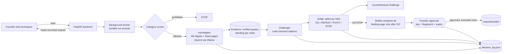

# VentureLab architecture

## Overview

VentureLab is a FastAPI application with a local open-weight model (Qwen3 through
Ollama) and four logical agents. The **Investigator** retrieves public sources and
extracts claims whose quotations Python checks against the retrieved text; the
**Challenger** reviews the founder's numbered assumptions, and code decides what each
review actually rests on; the **Judge** is a fixed, ordered set of Python rules
(`gates.py`) that returns GO, REPEAT, PIVOT or STOP with a counterfactual explanation
(`counterfactual.py`); the **Builder** prepares an experiment kit (and, after GO, a local
landing page) that is written only after founder approval bound to the artifact's SHA-256
fingerprint. The founder web workspace (`app/ui`) drives all of it through the API in
`app/api.py`; runs execute in a background worker (`jobs.py`). Every agent action is
appended to `decision_log.json`.



Every arrow runs in the integrated application. The founder key never leaves the
founder's machine except inside a decision the founder submits.

## Phases

| Phase | Objective | Agents | Founder approval | Status |
|---|---|---|---|---|
| 1 Discover | Is the stated problem real for these customers? | Investigator, Challenger, Judge | Not needed (nothing leaves the machine) | **Working** in the web workspace and CLI |
| 2 Validate | Design an experiment that could disprove the assumption | Builder (kit), Judge (rules) | Approve exact kit and proposed thresholds | **Working** (plan and kit); recording real results is **STUBBED** |
| 3 Build | Local landing-page prototype for the concept | Builder | Approve exact page fingerprint | **Working** after a GO decision; local files only |
| 4 Commercial Setup | Pricing hypotheses, positioning, costs | (future) | Required for any commitment | **STUBBED** |
| 5 Launch | Channel experiment, publishing | (future) | Separate approval per send or publish | **STUBBED** |
| 6 Operate & Learn | Compare real results with pre-set criteria | Judge (future) | Required for any change in real world | **STUBBED** |

### 1. Discover

- **Inputs**: a founder brief from the workspace form, validated by `brief.FounderBrief`
  (idea, customer, problem, market, skills, hours, budget and currency, values and
  constraints, optional source URLs, optional pass marks set in advance).
- **Method**: the category screen runs first. The Investigator plans searches, fetches
  Hacker News comments (Algolia API) and founder-listed pages (`sources.py`), keeps only
  comments relevant to the brief (`relevance.py`, a small documented concept list),
  and the model proposes claims as passage references; Python copies the quotation,
  checks wording and attribution, and assigns a standing (`evidence.py`): ESTABLISHED,
  NEEDS_REVIEW, partial, unsupported, contradicted or assumption. Unavailable sources
  are recorded as unavailable. The Challenger reviews assumptions A1 to A6; code
  classifies every citation (direct, indirect, irrelevant, contradictory) and resets
  any stance the cited findings do not support (`agents/challenger.py`).
- **Outputs**: `outputs/runs/<run>/phase1_step1_founder_brief.json`,
  `phase1_step2_investigation.*`, `phase1_step3_challenge.*`, `phase1_gate_decision.*`
  (command-line runs write the same files to `outputs/`).
- **Gate**: phase 1 evidence gate (below).

### 2. Validate

- **Inputs**: the finished run, mapped by `builder_adapter.py` to the Builder's
  `BuilderInput`: the founder's own words, the Challenger's assumptions with their
  code-computed basis and stance, verified quotations only (labelled
  UNVERIFIED_CONTEXT), the founder's constraints and the gate outcome.
- **Method**: the Builder writes a hypothesis, a non-leading past-behaviour interview
  guide, an ethical experiment, success and failure criteria labelled PROPOSED
  ASSUMPTION, and next steps. The model may only choose which supplied assumption to
  test; it writes no factual prose. Nothing is sent to anyone.
- **Outputs**: `outputs/builder/<run>/<action>/phase2_step1_validation-kit.json` / `.md`,
  written only after approval.
- **Gate**: founder approval of the exact kit; real results would later feed the
  `STOP_FAILED_VALIDATION_CONDITION` rule (results entry is STUBBED).

### 3. Build

- **Method**: only after a GO decision, a fixed, escaped HTML/CSS template renders a
  landing-page spec built from the founder's own words with a neutral product name: no
  forms, scripts, tracking or external assets, with ASSUMPTION labels and no
  testimonials, counts or urgency. Content rules reject common prohibited claims.
- **Outputs**: `phase3_step1_landing-spec.json` and `phase3_step1_landing-page.html` in the
  same approved folder; the workspace previews HTML only through an inert sandbox.
- **Gate**: generation approval. It never authorizes publishing or sending.

### 4. Commercial Setup (STUBBED)

Would record pricing and positioning hypotheses and setup tasks for founder review.
No accounts, contracts, regulated advice or payments are created.

### 5. Launch (STUBBED)

Would prepare launch copy and a channel experiment. Every external publish or send
would need its own approval bound to exact content, destination and action.

### 6. Operate & Learn (STUBBED)

Would compare genuinely observed results with criteria approved before testing and
return contradictions to Discover. No results are ever synthesized.

## Gates

The phase 1 gate (`gates.py`) contains no model. Rules are checked in a fixed order;
the first that applies decides, and every check up to it is recorded in the output:

1. `STOP_PROHIBITED_CATEGORY`: physical goods, financial/investment/crypto, health or
   legal advice (keyword screen, matched words are shown).
2. `STOP_FAILED_VALIDATION_CONDITION`: a real result is below a pass mark the founder
   set before testing.
3. `STOP_CONTRADICTED`: at least 2 independent sources contradict the problem and no
   established finding supports it or any alternative.
4. `PIVOT_ALTERNATIVE_SUPPORTED`: the problem is contradicted and an established finding
   points to a different problem for the same customers.
5. `REPEAT_MIXED_EVIDENCE`, `REPEAT_NO_READABLE_SOURCES`, `REPEAT_CLARIFY_AVAILABILITY`.
6. `GO_TO_FURTHER_VALIDATION`: at least 2 independent sources support the problem and
   nothing contradicts it. GO means "run customer experiments next", never proof of
   demand or product-market fit.
7. `REPEAT_INSUFFICIENT_EVIDENCE`: the default when evidence is too thin.

A source supports the problem in one of two ways, and each source counts once:
- an ESTABLISHED customer-problem finding about the founder's statement; or
- a **corroborating check**: the founder's statement is tested against each relevant
  commenter separately, in that person's exact verified words ("One commenter says that
  they personally, as one of the target customers (…), experience this problem: …"). Code
  only checks passages in the commenter's own first-person words, never quoted material
  (`>` lines). A check counts only if the assessment says it fully supports the claim
  **and** the sceptical second check agrees (including whether the speaker is that
  customer, not a developer, vendor or reporter). Partial support never counts, and each
  person and each wording counts once whatever URL it appears under. The check is about
  one person, so it is never ESTABLISHED and never evidence of a market.

NEEDS_REVIEW, partial, off-topic, competitor, segment and demand findings never satisfy
a requirement. Retrieved comments that contain instructions to an AI ("ignore previous
instructions", "answer with verdict…") are untrusted as a whole: never shown to the
model, quoted or used as context, and logged. Missing evidence gives REPEAT, not STOP, because absence of desk evidence
is not evidence of absence; STOP needs a prohibited category, a failed pre-set
condition or independent contradiction. The Counterfactual Challenge names the unmet
requirement and the experiment that could change the result, and states that more
evidence does not guarantee GO.

The gate also decides what the Builder may do: STOP blocks it (in the adapter, the API
and the artifact bundle itself); REPEAT and PIVOT allow the experiment kit only; GO adds
the landing page. Builder actions then pass the founder approval gate, enforced in the
backend: the founder's local key, the exact action, run and SHA-256 fingerprint, a
two-hour expiry, and single use. The workspace cannot change any of these results.

## Sale to cash

Architecture only, **STUBBED**, and deliberately not implemented. VentureLab processes
no real or sandbox payments, collects no payment credentials and spends nothing. A
future permitted design would: create an order only after founder-approved pricing;
treat a provider's confirmed payment event as the only trigger for delivery; revoke
access on refund; use an idempotency key per order so a repeated event cannot deliver
twice; and reconcile orders, payments, fees and payouts daily, flagging mismatches for
human review. None of this exists in the code, and `outputs/payment_test_log.md` is
intentionally absent.

## Data flow

```text
workspace form --POST /api/runs--> FounderBrief + category screen --> run record (SQLite)
                                                                      |
                                       background worker: orchestrator.run_discover
                                                                      v
  Investigator --sources, quotes--> evidence.py --> Challenger --> gates.py + counterfactual
        |                                                                   |
        +-------------------> outputs/runs/<run>/phase1_* <-----------------+
                                         |
                    GET /api/runs/<run>/... (findings, challenges, decision, counterfactual)
                                         |
  POST /api/runs/<run>/builder --> builder_adapter --> Builder prepare --> ApprovalStore
                                         (pending, SHA-256, expiry; nothing written)
                                         |
  POST /api/approvals/<id>/decision  (founder key, fingerprint, run) --> approved / rejected
  POST /api/approvals/<id>/execute   (founder key)  --> outputs/builder/<run>/<id>/phase2_*, phase3_*

every agent action --> {timestamp, agent, action, sources, model, cost, approved_by,
                        run_id, ...} --> decision_log.json
approval events    --> HMAC-chained approval store (authoritative) --> mirrored to decision_log.json
```

Founder briefs, retrieved public text, model output, artifacts, approval decisions and
audit records all stay on the local machine in `outputs/`, `decision_log.json` and the
ignored `.venturelab/` state directory (run records, approval store, founder key).
Nothing is deleted automatically; the founder decides what to commit or share.

## Built vs. stubbed

| Component | Status |
|---|---|
| Health checks, Ollama client, Compose stack with persistent local state | Built, tested |
| Founder web workspace connected to the backend API | Built, tested (unit, browser, API integration) |
| Background runs with progress, duplicate and queue limits | Built, tested; queue in memory, interrupted runs reported |
| Brief validation, category screen | Built, tested |
| Investigator, relevance selection, evidence verification | Built, live-run |
| Challenger with code-checked grounding | Built, live-run |
| Gate and counterfactual | Built, deterministic, tested |
| Builder (kit; landing page after GO), adapter from the research run | Built, tested; kit live-run and founder-approved |
| Founder approval: key, fingerprint, run, expiry, single use, audit | Built, tested, bypass attempts refused on the live server |
| Validate-phase results entry | STUBBED |
| Commercial Setup, Launch, Operate & Learn | STUBBED |
| Payments | STUBBED by policy |

Known limits: relevance is a keyword and concept list, not semantic understanding; the
extraction model sometimes generalises or misattributes claims (the checks hold those
back as NEEDS_REVIEW, which also makes ESTABLISHED evidence scarce); whether a
first-person comment really comes from the target customer is decided by two model
judgements, not by code (two earlier GO results were wrong for this reason, see
[docs/evaluation-runs.md](docs/evaluation-runs.md)); no recorded run reaches GO under the
corrected rule, so the landing page has been prepared live but never approved; the founder
key is a single-machine capability, not an account system.

## Roadmap

1. Record real experiment results against the founder's pre-set pass marks and feed
   them back into the gate (Validate, then Operate & Learn).
2. Evidence quality: semantic relevance instead of keyword matching, stronger
   attribution checks, measured on the held-out benchmark set.
3. Human review queue for NEEDS_REVIEW findings, recorded in the audit log.
4. Durable job queue and multi-founder accounts, if the tool is used beyond one machine.
5. Design-only phases one at a time, each with its own approval-gated actions.
