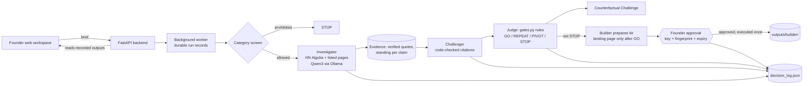

# VentureLab architecture

## Overview

VentureLab is a FastAPI application with a local open-weight model (Qwen3 through
Ollama) and four logical agents. The **Investigator** retrieves public sources and
extracts claims whose quotations Python checks against the retrieved text; the
**Challenger** reviews the founder's numbered assumptions, and code decides what each
review actually rests on; the **Judge** is a fixed, ordered set of Python rules
(`gates.py`) that returns GO, REPEAT, PIVOT or STOP with a counterfactual explanation
(`counterfactual.py`); the **Builder** prepares an experiment kit (and, after GO, a local
landing page) that is written only after founder approval bound to the artifact's SHA-256
fingerprint. The founder web workspace (`app/ui`) drives all of it through the API in
`app/api.py`; runs execute in a background worker (`jobs.py`). Every agent action is
appended to `decision_log.json`.



Every arrow runs in the integrated application. The founder key never leaves the
founder's machine except inside a decision the founder submits.

## Phases

| Phase | Objective | Agents | Founder approval | Status |
|---|---|---|---|---|
| 1 Discover | Is the stated problem real for these customers? | Investigator, Challenger, Judge | Public retrieval only; no publishing or outreach | **Working** in the web workspace and CLI |
| 2 Validate | Design an experiment that could disprove the assumption | Builder (kit), Judge (rules) | Approve exact kit and proposed thresholds | **Working** (plan and kit); recording real results is **STUBBED** |
| 3 Build | Local landing-page prototype for the concept | Builder | Approve exact page fingerprint | **Working** after a GO decision; local files only |
| 4 Commercial Setup | Pricing hypotheses, positioning, costs | (future) | Required for any commitment | **STUBBED** |
| 5 Launch | Channel experiment, publishing | (future) | Separate approval per send or publish | **STUBBED** |
| 6 Operate & Learn | Compare real results with pre-set criteria | Judge (future) | Required for any change in real world | **STUBBED** |

### 1. Discover

- **Inputs**: a founder brief from the workspace form, validated by `brief.FounderBrief`
  (idea, customer, problem, market, skills, hours, budget and currency, values and
  constraints, optional source URLs, optional pass marks set in advance).
- **Method**: the category screen runs first. The Investigator plans searches, fetches
  Hacker News comments (Algolia API) and founder-listed pages (`sources.py`), keeps only
  comments relevant to the brief (`relevance.py`, a small documented concept list),
  and the model proposes claims as passage references; Python copies the quotation,
  checks wording and attribution, and assigns a standing (`evidence.py`): ESTABLISHED,
  NEEDS_REVIEW, partial, unsupported, contradicted or assumption. Unavailable sources
  are recorded as unavailable. The Challenger reviews assumptions A1 to A6; code
  classifies every citation (direct, indirect, irrelevant, contradictory) and resets
  any stance the cited findings do not support (`agents/challenger.py`).
- **Outputs**: `outputs/runs/<run>/phase1_step1_founder_brief.json`,
  `phase1_step2_investigation.*`, `phase1_step3_challenge.*`, `phase1_gate_decision.*`
  (command-line runs write the same files to `outputs/`).
- **Gate**: phase 1 evidence gate (below).

**Remaining Discover design (STUBBED):** the Investigator would turn an ambiguous
starting idea into candidate problem/customer pairs, compare alternatives using
explicit founder-weighted criteria (pain, reachable customers, feasibility, cost,
and ethical fit), and preserve sources or ASSUMPTION labels for every score.
The founder chooses the pair; a high score alone cannot satisfy the evidence gate.
Market definition records the customer, geography, alternatives and reachable
channels; unsupported market-size estimates remain assumptions. The existing
Builder supplies past-behaviour interview questions; recruiting, interviewing and
recording answers remain manual. Interviews must ask about actual recent behaviour,
existing workarounds and costs before proposing the product, without leading sales
questions or interpreting polite interest as demand.

### 2. Validate

- **Inputs**: the finished run, mapped by `builder_adapter.py` to the Builder's
  `BuilderInput`: the founder's own words, the Challenger's assumptions with their
  code-computed basis and stance, verified quotations only (labelled
  UNVERIFIED_CONTEXT), the founder's constraints and the gate outcome.
- **Method**: the Builder writes a hypothesis, a non-leading past-behaviour interview
  guide, an ethical experiment, success and failure criteria labelled PROPOSED
  ASSUMPTION, and next steps. The model may only choose which supplied assumption to
  test; it writes no factual prose. Nothing is sent to anyone.
- **Outputs**: `outputs/builder/<run>/<action>/phase2_step1_validation-kit.json` / `.md`,
  written only after approval.
- **Gate**: founder approval of the exact kit; real results would later feed the
  `STOP_FAILED_VALIDATION_CONDITION` rule (results entry is STUBBED).

**Remaining Validate design (STUBBED):** a versioned Lean Canvas would link problem,
customer, value proposition, solution, channels, revenue, costs, key metrics and
advantage to finding IDs or explicit assumptions. The Builder would propose a
landing-page demand experiment with a fixed audience, duration, denominator,
conversion definition and pass/fail criteria. Founder approval binds the exact
page, destinations and thresholds before launch. Traffic, sign-ups and interview
results must be observed and consented, never synthesized; duplicate or missing
observations are flagged. Below-threshold results recommend STOP or a justified
PIVOT; incomplete data gives REPEAT. No payment collection is part of this test.
The current passive local page has no form or tracking and cannot measure demand.

### 3. Build

- **Method**: only after a GO decision, a fixed, escaped HTML/CSS template renders a
  landing-page spec built from the founder's own words with a neutral product name: no
  forms, scripts, tracking or external assets, with ASSUMPTION labels and no
  testimonials, counts or urgency. Content rules reject common prohibited claims.
- **Outputs**: `phase3_step1_landing-spec.json` and `phase3_step1_landing-page.html` in the
  same approved folder; the workspace previews HTML only through an inert sandbox.
- **Gate**: generation approval. It never authorizes publishing or sending.

**Remaining Build design (STUBBED):** the Builder would derive a narrowly scoped
MVP specification and acceptance criteria from validated needs, produce application
code, user documentation and setup instructions, then run unit and user-journey
checks in an isolated environment with no credentials. Test reports must record
actual commands, failures and limitations. The Judge would require passing critical
acceptance checks, explicit unresolved risks and founder review before release;
failures return REPEAT. A static landing page is not a complete tested product.
Application tests in this repository test VentureLab, not an automatically built MVP.

### 4. Commercial Setup (STUBBED)

- **Agents/tools:** proposed Builder templates and deterministic completeness checks;
  no account creation or payment provider integration.
- **Inputs/method:** validated offer, founder constraints and observed costs. Draft
  pricing alternatives with explicit assumptions about willingness to pay, marginal
  cost and support time. Compare unit economics under low/base/high usage without
  implying revenue or income is guaranteed.
- **Outputs:** versioned pricing rationale, positioning, draft terms, privacy and
  refund policies. Policies identify data collected, purpose, retention, deletion,
  delivery limitations and support contact; they are drafts for founder review,
  not legal advice. Missing jurisdiction-specific requirements are unresolved tasks.
- **Gate:** founder accepts the exact offer and drafts; missing facts give REPEAT,
  unacceptable privacy or ethical constraints give STOP. Approval does not permit
  collecting payments, signing terms or publishing.

### 5. Launch (STUBBED)

- **Agents/tools:** proposed Builder copy templates and a local mock fulfillment
  state machine; all payment and delivery events visibly MOCKED.
- **Inputs/method:** approved product version, pricing hypothesis and policy drafts.
  Prepare a store page and channel-specific posts with source/ASSUMPTION labels,
  accurate capabilities and limitations, and no invented reviews, sign-ups or urgency.
- **Outputs:** draft store page, posts, channel experiment plan and mock delivery
  receipt. Every external publish/send would require a separate approval bound to
  exact content, destination, expiry and action. No such external action is built.
- **Gate:** check content, asset version, required policy links and explicit founder
  approval. Failed checks give REPEAT; prohibited offers give STOP. Local mock
  fulfillment demonstrates the intended flow without customers, charges or email.

### 6. Operate & Learn (STUBBED)

- **Agents/tools:** proposed support triage, deterministic metric aggregation and
  Challenger/ Judge review; no automatic customer replies.
- **Inputs/method:** consented support reports and actual experiment observations,
  with timestamps, provenance, denominators and missing-data flags. Track activation,
  successful deliveries, failures, support burden and retention by cohort; never
  treat simulated events as observed demand. Draft replies require founder review.
- **Outputs:** support summary, metric definitions and a persevere/pivot memo linking
  each conclusion to observations, the pre-set thresholds and unresolved assumptions.
- **Gate:** persevere only when the pre-set criteria hold; PIVOT for supported
  alternatives, REPEAT for inadequate observations, STOP for failed conditions or
  unacceptable harm. New assumptions return to Discover; changed product versions
  invalidate prior launch approval. No results are synthesized.

## Gates

The phase 1 gate (`gates.py`) contains no model. Rules are checked in a fixed order;
the first that applies decides, and every check up to it is recorded in the output:

1. `STOP_PROHIBITED_CATEGORY`: physical goods, financial/investment/crypto, health or
   legal advice (keyword screen, matched words are shown).
2. `STOP_FAILED_VALIDATION_CONDITION`: a real result is below a pass mark the founder
   set before testing.
3. `STOP_CONTRADICTED`: at least 2 independent sources contradict the problem and no
   established finding supports it or any alternative.
4. `PIVOT_ALTERNATIVE_SUPPORTED`: the problem is contradicted and an established finding
   points to a different problem for the same customers.
5. `REPEAT_MIXED_EVIDENCE`, `REPEAT_NO_READABLE_SOURCES`, `REPEAT_CLARIFY_AVAILABILITY`.
6. `GO_TO_FURTHER_VALIDATION`: at least 2 independent sources support the problem and
   nothing contradicts it. GO means "run customer experiments next", never proof of
   demand or product-market fit.
7. `REPEAT_INSUFFICIENT_EVIDENCE`: the default when evidence is too thin.

A source supports the problem in one of two ways, and each source counts once:
- an ESTABLISHED customer-problem finding about the founder's statement; or
- a **corroborating check**: the founder's statement is tested against each relevant
  commenter separately, in that person's exact verified words ("One commenter says that
  they personally, as one of the target customers (…), experience this problem: …"). Code
  only checks passages in the commenter's own first-person words, never quoted material
  (`>` lines). A check counts only if the assessment says it fully supports the claim
  **and** the sceptical second check agrees (including whether the speaker is that
  customer, not a developer, vendor or reporter). Partial support never counts, and each
  person and each wording counts once whatever URL it appears under. The check is about
  one person, so it is never ESTABLISHED and never evidence of a market.

NEEDS_REVIEW, partial, off-topic, competitor, segment and demand findings never satisfy
a requirement. Retrieved comments that contain instructions to an AI ("ignore previous
instructions", "answer with verdict…") are untrusted as a whole: never shown to the
model, quoted or used as context, and logged. Missing evidence gives REPEAT, not STOP, because absence of desk evidence
is not evidence of absence; STOP needs a prohibited category, a failed pre-set
condition or independent contradiction. The Counterfactual Challenge names the unmet
requirement and the experiment that could change the result, and states that more
evidence does not guarantee GO.

The gate also decides what the Builder may do: STOP blocks it (in the adapter, the API
and the artifact bundle itself); REPEAT and PIVOT allow the experiment kit only; GO adds
the landing page. Every decision records the gate rule set version; a decision made
under an earlier version is superseded. The backend refuses to prepare, approve or execute
Builder work for a superseded decision, checking the recorded run again on every request
(so a restart changes nothing). Files already written stay as they are, and recorded
decisions are never rewritten. Builder actions then pass the founder approval gate, enforced in the
backend: the founder's local key, the exact action, run and SHA-256 fingerprint, a
two-hour expiry, and single use. The workspace cannot change any of these results.

## Sale to cash

Architecture only, **STUBBED**. All proposed events below are **MOCKED**:
VentureLab processes no real or sandbox payments, stores no payment credentials,
and spends nothing. The stricter no-payments constraint applies to this design.

```text
founder-approved local simulation -> mock order (product version + price assumption)
  -> mock payment-confirmed event -> one local delivery receipt
  -> mock refund event -> revoke simulated access
  -> reconciliation report (mock orders, payments, fees and payouts)
```

The mock order has a unique ID, explicit simulated status and approved product hash.
A mock payment-confirmed event is the only delivery trigger; a pending or failed event
cannot deliver. A unique event ID and order/product idempotency key prevent duplicate
delivery on retry. Delivery writes a local receipt pointing to the approved local
artifact, never sends email or grants real access. A mock refund revokes simulated
access; duplicate refunds are no-ops. Out-of-order or unknown-order events are held
for manual review, not guessed. Reconciliation compares recorded mock order totals,
payment totals, fee assumptions and payouts and lists mismatches explicitly.

These components and tests are not implemented; `outputs/payment_test_log.md` is
intentionally absent. Any later test log must come from executing this mock flow,
label every event MOCKED and never imply that money moved.

## Data flow

```text
workspace form --POST /api/runs--> FounderBrief + category screen --> run record (SQLite)
                                                                      |
                                       background worker: orchestrator.run_discover
                                                                      v
  Investigator --sources, quotes--> evidence.py --> Challenger --> gates.py + counterfactual
        |                                                                   |
        +-------------------> outputs/runs/<run>/phase1_* <-----------------+
                                         |
                    GET /api/runs/<run>/... (findings, challenges, decision, counterfactual)
                                         |
  POST /api/runs/<run>/builder --> builder_adapter --> Builder prepare --> ApprovalStore
                                         (pending, SHA-256, expiry; nothing written)
                                         |
  POST /api/approvals/<id>/decision  (founder key, fingerprint, run) --> approved / rejected
  POST /api/approvals/<id>/execute   (founder key)  --> outputs/builder/<run>/<id>/phase2_*, phase3_*

every agent action --> {timestamp, agent, action, sources, model, cost, approved_by,
                        run_id, ...} --> decision_log.json
approval events    --> HMAC-chained approval store (authoritative) --> mirrored to decision_log.json
```

Founder briefs, retrieved public text, model output, artifacts, approval decisions and
audit records all stay on the local machine in `outputs/`, `decision_log.json` and the
ignored `.venturelab/` state directory (run records, approval store, founder key).
Public retrieval sends search queries and page requests to external sources; the
model runs locally. The founder should avoid sensitive details in search context.
Nothing is deleted automatically; the founder decides what to commit or share.

Recorded-execution browsing is separate from live state: `app/recorded_runs.json`
allowlists genuine committed runs and their SHA-256 file checksums. The read-only
`/api/recordings` router verifies files before serving them; it never restores a
SQLite run, an approval or execution authority. Earlier rule versions are explicitly
superseded. Checksums detect changes relative to the index, not whether claims are
true. `tools/index_recordings.py` rebuilds the index from tracked outputs and actual
matching audit entries; review provenance before updating it.

## Built vs. stubbed

| Component | Status |
|---|---|
| Health checks, Ollama client, Compose stack with persistent local state | Built, tested |
| Founder web workspace connected to the backend API | Built, tested (unit, browser, API integration) |
| Background runs with progress, duplicate and queue limits | Built, tested; queue in memory, interrupted runs reported |
| Brief validation, category screen | Built, tested |
| Investigator, relevance selection, evidence verification | Built, live-run |
| Challenger with code-checked grounding | Built, live-run |
| Gate and counterfactual | Built, deterministic, tested |
| Builder (kit; landing page after GO), adapter from the research run | Built, tested; kit live-run and founder-approved |
| Founder approval: key, fingerprint, run, expiry, single use, audit | Built, tested, bypass attempts refused on the live server |
| Validate-phase results entry | STUBBED |
| Commercial Setup, Launch, Operate & Learn | STUBBED |
| Payments | STUBBED by policy |

Known limits: relevance is a keyword and concept list, not semantic understanding; the
extraction model sometimes generalises or misattributes claims (the checks hold those
back as NEEDS_REVIEW, which also makes ESTABLISHED evidence scarce); whether a
first-person comment really comes from the target customer is decided by two model
judgements, not by code (two earlier GO results were wrong for this reason, see
[docs/evaluation-runs.md](docs/evaluation-runs.md)); no recorded run reaches GO under the
corrected rule, so the landing page has been prepared live but never approved; the founder
key is a single-machine capability, not an account system.

## Roadmap

1. Record real experiment results against the founder's pre-set pass marks and feed
   them back into the gate (Validate, then Operate & Learn).
2. Evidence quality: semantic relevance instead of keyword matching, stronger
   attribution checks, measured on the held-out benchmark set.
3. Human review queue for NEEDS_REVIEW findings, recorded in the audit log.
4. Durable job queue and multi-founder accounts, if the tool is used beyond one machine.
5. Design-only phases one at a time, each with its own approval-gated actions.
