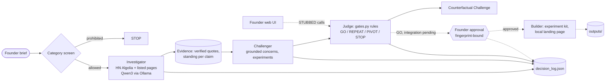

# VentureLab architecture

## Overview

VentureLab is a FastAPI application with a local open-weight model (Qwen3 through
Ollama) and four logical agents. The **Investigator** retrieves public sources and
extracts claims whose quotations Python checks against the retrieved text; the
**Challenger** questions the founder's assumptions using only those findings; the
**Judge** is a fixed, ordered set of Python rules (`gates.py`) that returns GO, REPEAT,
PIVOT or STOP with a counterfactual explanation (`counterfactual.py`); the **Builder**
prepares an experiment kit and a local landing page that are written only after
founder approval bound to the artifact's SHA-256 fingerprint. Every agent action is
appended to `decision_log.json`.

What exists where (observed 2026-11-17; nothing below is integrated unless marked):

- `main`: FastAPI health/status app, Ollama client, founder brief and category screen,
  Investigator, Challenger, evidence verification, phase 1 gate, counterfactual,
  orchestrator CLI and audit log.
- `fix/milestone2-evidence-quality`: Investigator/Challenger quality fixes; not merged.
- `feature/milestone3-builder`: Builder, approval store, founder CLI; not merged.
- `feature/milestone4-ui`: founder web interface with STUBBED backend calls; not merged.



Solid arrows run today on `main`. Dotted arrows exist on feature branches or as
interfaces only, and are not connected yet.

## Phases

| Phase | Objective | Agents | Founder approval | Status |
|---|---|---|---|---|
| 1 Discover | Is the stated problem real for these customers? | Investigator, Challenger, Judge | Not needed (nothing leaves the machine) | **Working** on `main` |
| 2 Validate | Design an experiment that could disprove the assumption | Builder (kit), Judge (rules) | Approve exact kit and proposed thresholds | **Working on M3 branch**, not integrated |
| 3 Build | Local landing-page prototype for the concept | Builder | Approve exact page fingerprint | **Working on M3 branch**, not integrated |
| 4 Commercial Setup | Pricing hypotheses, positioning, costs | (future) | Required for any commitment | **STUBBED** |
| 5 Launch | Channel experiment, publishing | (future) | Separate approval per send or publish | **STUBBED** |
| 6 Operate & Learn | Compare real results with pre-set criteria | Judge (future) | Required for any change in real world | **STUBBED** |

### 1. Discover

- **Inputs**: a validated founder brief (`brief.py`): idea, customer, problem, skills,
  hours, budget, optional source URLs and optional pass marks set in advance.
- **Method**: the category screen runs first. The Investigator plans searches, fetches
  Hacker News comments (Algolia API) and founder-listed pages (`sources.py`), and the
  model proposes claims as passage references; Python copies the quotation, checks it
  exists in the retrieved text and assigns a standing (`evidence.py`): ESTABLISHED,
  NEEDS_REVIEW, partial evidence or assumption. Unavailable sources are recorded as
  unavailable. The Challenger produces concerns tied to finding IDs, missing
  information and experiments (`agents/challenger.py`).
- **Outputs**: `outputs/phase1_step1_founder_brief*.json`,
  `phase1_step2_investigation*`, `phase1_step3_challenge*`, `phase1_gate_decision*`.
- **Gate**: phase 1 evidence gate (below).

### 2. Validate

- **Inputs**: a brief admitted by the gate, mapped to the Builder input
  (`Milestone2Adapter`, not yet implemented).
- **Method**: the Builder writes a hypothesis, a non-leading past-behaviour interview
  guide, an ethical experiment, success and failure criteria labelled PROPOSED
  ASSUMPTION, and next steps. The model may only choose which supplied assumption to
  test; it writes no factual prose. Nothing is sent to anyone.
- **Outputs**: `phase2_step1_validation-kit.json` / `.md` (M3 branch).
- **Gate**: founder approval of the exact kit; real results would later feed the
  `STOP_FAILED_VALIDATION_CONDITION` rule.

### 3. Build

- **Method**: a fixed, escaped HTML/CSS template renders a validated landing-page spec:
  no forms, scripts, tracking or external assets, with ASSUMPTION labels and no
  testimonials, counts or urgency. Content rules reject common prohibited claims.
- **Outputs**: `phase3_step1_landing-spec.json`, `phase3_step1_landing-page.html` and
  the approval receipt `phase3_gate_founder-approval.json` (M3 branch).
- **Gate**: generation approval. It never authorizes publishing or sending.

### 4. Commercial Setup (STUBBED)

Would record pricing and positioning hypotheses and setup tasks for founder review.
No accounts, contracts, regulated advice or payments are created.

### 5. Launch (STUBBED)

Would prepare launch copy and a channel experiment. Every external publish or send
would need its own approval bound to exact content, destination and action.

### 6. Operate & Learn (STUBBED)

Would compare genuinely observed results with criteria approved before testing and
return contradictions to Discover. No results are ever synthesized.

## Gates

The phase 1 gate (`gates.py`) contains no model. Rules are checked in a fixed order;
the first that applies decides, and every check up to it is recorded in the output:

1. `STOP_PROHIBITED_CATEGORY`: physical goods, financial/investment/crypto, health or
   legal advice (keyword screen, matched words are shown).
2. `STOP_FAILED_VALIDATION_CONDITION`: a real result is below a pass mark the founder
   set before testing.
3. `STOP_CONTRADICTED`: at least 2 independent sources contradict the problem and no
   established finding supports it or any alternative.
4. `PIVOT_ALTERNATIVE_SUPPORTED`: the problem is contradicted and an established finding
   points to a different problem for the same customers.
5. `REPEAT_MIXED_EVIDENCE`, `REPEAT_NO_READABLE_SOURCES`, `REPEAT_CLARIFY_AVAILABILITY`.
6. `GO_TO_FURTHER_VALIDATION`: at least 2 established, relevant problem findings from at
   least 2 sources and no contradiction. GO means "run customer experiments next",
   never proof of demand or product-market fit.
7. `REPEAT_INSUFFICIENT_EVIDENCE`: the default when evidence is too thin.

Only ESTABLISHED customer-problem findings about the founder's statement count.
NEEDS_REVIEW, partial, off-topic, competitor, segment and demand findings never satisfy
a requirement. Missing evidence gives REPEAT, not STOP, because absence of desk evidence
is not evidence of absence; STOP needs a prohibited category, a failed pre-set
condition or independent contradiction. The Counterfactual Challenge names the unmet
requirement and the experiment that could change the result, and states that more
evidence does not guarantee GO. A founder can reject any Builder action; approval is
enforced in backend code (M3 branch), not only in the UI.

## Sale to cash

Architecture only, **STUBBED**, and deliberately not implemented. VentureLab processes
no real or sandbox payments, collects no payment credentials and spends nothing. A
future permitted design would: create an order only after founder-approved pricing;
treat a provider's confirmed payment event as the only trigger for delivery; revoke
access on refund; use an idempotency key per order so a repeated event cannot deliver
twice; and reconcile orders, payments, fees and payouts daily, flagging mismatches for
human review. None of this exists in the code, and `outputs/payment_test_log.md` is
intentionally absent.

## Data flow

```text
founder brief (JSON) --validate+screen--> Investigator --sources, quotes--> evidence.py
   [main, CLI]                              |                                  |
                                            v                                  v
                                       Challenger <---------- verified findings + standing
                                            |
                                            v
                          gates.py rules --> decision + counterfactual --> outputs/phase1_*
                                            |
              (integration boundary: Milestone2Adapter -> BuilderInput, not built yet)
                                            v
              Builder prepare --> ApprovalStore (pending, SHA-256) --> founder decide
                                            |                     (M3 CLI; M4 UI STUBBED)
                                            v
                                 execute once --> outputs/<run>/<action>/phase2_*, phase3_*

every agent action --> audit entry {timestamp, agent, action, sources, model, cost,
                       approved_by, ...} --> decision_log.json (main) / approval DB (M3)
```

Founder-submitted briefs, retrieved public text, model output, artifacts, approval
decisions and audit records all stay on the local machine in `outputs/`,
`decision_log.json` and (M3) an ignored `.venturelab/` state directory. Nothing is
deleted automatically; the founder decides what to commit or share.

## Built vs. stubbed

| Component | Where | Status |
|---|---|---|
| Health/status app, Ollama client, Compose stack | `main` | Built, tested, clean-clone checked |
| Brief validation, category screen | `main` | Built, tested |
| Investigator, evidence verification | `main` | Built, live-run; quality fixes on `fix/milestone2-evidence-quality` |
| Challenger | `main` | Built, live-run |
| Gate and counterfactual | `main` | Built, deterministic, tested |
| Builder, approval store, founder CLI | `feature/milestone3-builder` | Built and tested on branch, not merged |
| Founder web UI | `feature/milestone4-ui` | Built on branch; backend calls STUBBED; demo data MOCKED |
| UI ↔ workflow ↔ Builder wiring | none | Not built (integration) |
| Commercial Setup, Launch, Operate & Learn | none | STUBBED |
| Payments | none | STUBBED by policy |

Known evidence-quality limits on `main` (from earlier review; fixes are on the quality
branch and must be re-tested after merge): misattributed claims, over-conservative
standing, irrelevant retrieved evidence, weak Challenger grounding and keyword/synonym
matching limits. No recorded real run has reached GO.

## Roadmap

1. Merge the quality, Builder and UI branches; wire UI → workflow → Builder → approval;
   regenerate outputs and one unified log from real integrated runs
   ([docs/integration-handoff.md](docs/integration-handoff.md)).
2. Evidence quality: semantic relevance instead of keyword matching, stronger
   attribution checks, measured on the held-out benchmark set.
3. Human review queue for NEEDS_REVIEW findings, recorded in the audit log.
4. Real experiment results feeding the pre-set pass marks (Operate & Learn).
5. Design-only phases one at a time, each with its own approval-gated actions.
