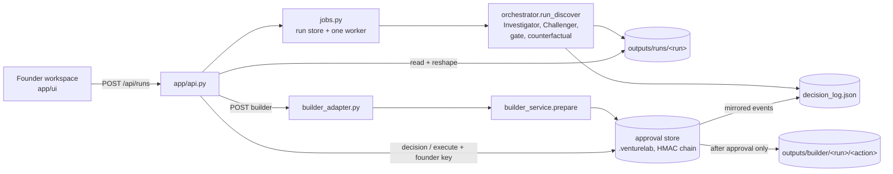

# Integration verification (Milestone 6)

Branch `integration/venturelab-complete`, built in a separate worktree from `origin/main`.
This document covers the integration only; project-wide submission documentation is
prepared separately (Milestone 5).

## Sources integrated

| Source | Branch | Commit | Merge |
|---|---|---|---|
| Foundation + Milestone 2 | `main` | `551a9e8` | base of the branch |
| Milestone 2 quality fixes | `fix/milestone2-evidence-quality` | `ac7afd5` | `af75334`, no conflicts |
| Milestone 3 Builder and approvals | `feature/milestone3-builder` | `b2a2f26` | `2e1c1c9`, conflict in `decision_log.json` |
| Milestone 4 founder workspace | `feature/milestone4-ui` | `60281e1` | `8c22392`, conflict in `.dockerignore` |

Conflict resolutions:
- `decision_log.json`: each branch had committed the log of its own demo. Neither was
  merged into the other. Both originals are kept unchanged in `docs/history/`; the root
  log was then emptied so it holds only the integrated application's own runs.
- `.dockerignore`: Milestone 3 excluded local approval state and outputs, Milestone 4
  excluded nested `node_modules`; all entries kept.
- `app/main.py` merged automatically: the old status page moved to `/diagnostics`, the
  workspace is served at `/`, and the new API router is registered.

## Architecture of the integrated application

No research, gate or approval logic is duplicated: the API calls the existing modules and
`app/presentation.py` only renames fields for the Milestone 4 contracts.

## API

| Method and path | Purpose |
|---|---|
| `POST /api/runs` | Validate the brief with Milestone 2's `FounderBrief` and queue a run. 202 with the run; 422 with field errors; 429 when the queue is full. An identical active brief returns the existing run. |
| `GET /api/runs`, `GET /api/runs/{id}` | Run list (most recent first) and status, stage and progress. |
| `GET /api/runs/{id}/agents` | Investigator, Challenger, Judge, Builder status from recorded progress. |
| `GET /api/runs/{id}/findings` | Findings with standing, relationship, verified quotes, source URL, limitations, related assumptions. |
| `GET /api/runs/{id}/challenges` | Assumption reviews with code-computed basis and stance, links, new hypotheses, risks. |
| `GET /api/runs/{id}/decision`, `/counterfactual` | The deterministic gate result and counterfactual, as recorded. |
| `GET /api/runs/{id}/audit` | `decision_log.json` entries for the run (pipeline and mirrored Builder/approval events). |
| `POST /api/runs/{id}/builder` | Prepare a Builder request (no files written). 409 if the run is not finished or the gate is STOP. |
| `GET /api/runs/{id}/approvals`, `/artifacts` | Requests with status and expiry; proposed or written artifacts. |
| `POST /api/approvals/{action}/decision` | Approve or reject; needs run ID, fingerprint, reason and the founder key. |
| `POST /api/approvals/{action}/execute` | Write the approved files; needs run ID and the founder key. |

## Runtime

- `docker compose up`, then open `http://localhost:8000`. The app container bind-mounts
  `.venturelab/` (run records, approval store, founder key), `outputs/` and
  `decision_log.json`, so state survives container restarts.
- Background jobs: one worker thread, at most `VENTURELAB_MAX_QUEUED_RUNS` (3) runs queued
  or running. States: queued, running, completed, failed, blocked. Run records are durable
  in SQLite; the queue is in memory, so a run interrupted by a restart is marked failed
  ("interrupted"), never resumed or reported complete.
- Blocked: if Ollama is unreachable or the model is not downloaded, the run is blocked
  before any research. A prohibited brief needs no model and stops immediately.
- The UI polls every 5 seconds on the workflow view and on any view while the selected run
  is queued or running.
- New settings (with defaults, in `.env.example`): `VENTURELAB_STATE_DIR`,
  `VENTURELAB_OUTPUT_DIR`, `VENTURELAB_DECISION_LOG`, `VENTURELAB_APPROVAL_TTL_S` (7200),
  `VENTURELAB_MAX_QUEUED_RUNS` (3).

## Builder integration

`builder_adapter.py` maps a finished run's recorded outputs to Milestone 3's `BuilderInput`:
founder idea, customer, problem and constraints verbatim; the Challenger's numbered
assumptions with their code-computed basis and stance; verified quotations only, tagged with
their standing (all `UNVERIFIED_CONTEXT` by Milestone 3's contract); budget and time; and the
gate outcome as `GateContext`. Gate rules (Milestone 3's rule, extended minimally):

| Gate | Builder |
|---|---|
| GO | Experiment kit and local landing page |
| REPEAT, PIVOT | Experiment kit and interview guide only (no landing page) |
| STOP | Blocked in the adapter, the API and `ArtifactBundle` itself |

Changes to Milestone 3 code, each covered by tests: `ArtifactBundle.landing_page` became
optional (kit-only bundles for REPEAT/PIVOT; STOP refused); `ApprovalStore` gained an expiry
window (decide and execute refused after `ttl_seconds` from the request), `verify_founder`,
`expires_at` and `list_requests`. Milestone 2 code gained `budget_currency` (no exchange
rate is ever applied), a caller-supplied run ID and a progress listener on the audit log.

## Founder approval and trust model

- The approval store (Milestone 3) is authoritative. Approval and execution need the founder
  capability: the 64-character key in `.venturelab/approvals.sqlite3.founder` on the
  founder's machine. The API never returns it; the founder pastes it into the approval page,
  where it stays in the tab's memory only. Requests without it are refused and recorded.
- Each decision is bound to action ID, run ID, artifact identity and SHA-256 fingerprint;
  execution re-checks all of them, consumes the approval once, and writes only to
  `outputs/builder/<run>/<action>`. Approval authorizes local files only; nothing is
  published, sent or paid.
- This is a single-founder, local capability check, not multi-user authentication. No
  cookies or sessions exist, so a cross-site request has no ambient authority to use.
- Artifacts are shown from the approved snapshot; files on disk that differ are flagged and
  not displayed. HTML is previewed through Milestone 4's inert sandboxed reconstruction.

## Audit log

The pipeline appends one entry per agent action to `decision_log.json` (Milestone 2 schema).
Builder and approval events are recorded first in the HMAC-chained approval store
(Milestone 3) and mirrored into `decision_log.json` with `"recorded_in": "approval_store"`;
the store remains authoritative. Every entry has `timestamp`, `agent`, `action`, `sources`,
`model`, `cost`, `approved_by`, plus `run_id` and, for Builder events, `action_id`,
`artifact_sha256` and `outcome`. Deterministic steps record `model: null`.

## Tests

| Suite | Result | Notes |
|---|---|---|
| Python offline (all milestones + integration) | 389 passed, 29 skipped | skipped = live model and browser opt-in tests |
| `tests/test_integration_api.py` | 21 passed | MOCKED model and sources; real code paths |
| JavaScript unit (`tests/ui/*.test.mjs`) | 20 passed | live adapter test rewritten for the real backend |
| Browser (Playwright, Edge) | 27 passed | MOCKED service transport, isolated state |
| Live model tests | see below | real Ollama `qwen3:4b` |

Browser-test changes: the copy "No venture runs are available." was kept; one assertion that
submission is disabled (a Milestone 4 stub) now expects it enabled; the Playwright server runs
with an isolated state directory so it can never touch a running application's state.

## Real end-to-end runs (live, through the web application)

| Run | Brief | Result | Time | Model calls |
|---|---|---|---|---|
| `run-64fdee373f244b81` | Slack-thread summaries for remote teams (new, permitted) | REPEAT, `REPEAT_INSUFFICIENT_EVIDENCE` | 174 s | 5 |
| `run-2978f51dd4c040b1` | Crypto trading-signals newsletter (prohibited) | STOP, `STOP_PROHIBITED_CATEGORY` | under 1 s | 0 |

The first run was submitted through the workspace form. It retrieved 3 Hacker News searches
(6 relevant comments), produced 2 findings that need review or are partial and 2 model
claims without verifiable quotes (kept as ASSUMPTION), and the Challenger's "supported"
stance on A3 was reset to untested by code. The Builder request was prepared through the
interface (kit only, because the gate said REPEAT). Live bypass attempts against the real
server were refused: execute without a key (403), with a guessed key (403), with another
run's ID (409), and an approval with a forged key (403); the request stayed pending and no
files existed. The STOP run's Builder request was refused (409).

## Known limitations

- A REPEAT or PIVOT run produces the experiment kit but no landing page (Milestone 3's rule);
  the landing page is exercised only by MOCKED integration tests, since no live run has
  reached GO.
- The job queue is in memory; interrupted runs are reported, not resumed.
- One founder, one machine: the founder key is a local capability, not an account system.
- Bind mounts assume Docker Desktop on Windows or macOS; on Linux the container user (uid
  1000) must be able to write the mounted folders.
- Validate-phase results entry, Commercial Setup, Launch and Operate & Learn remain STUBBED.
